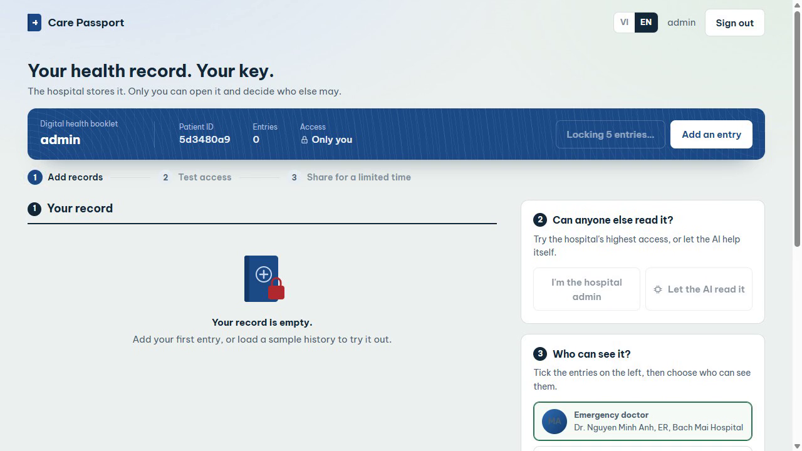
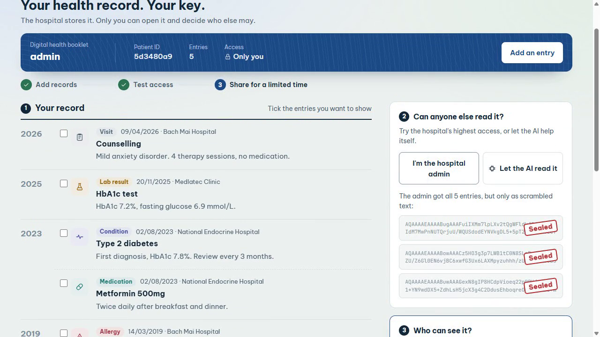
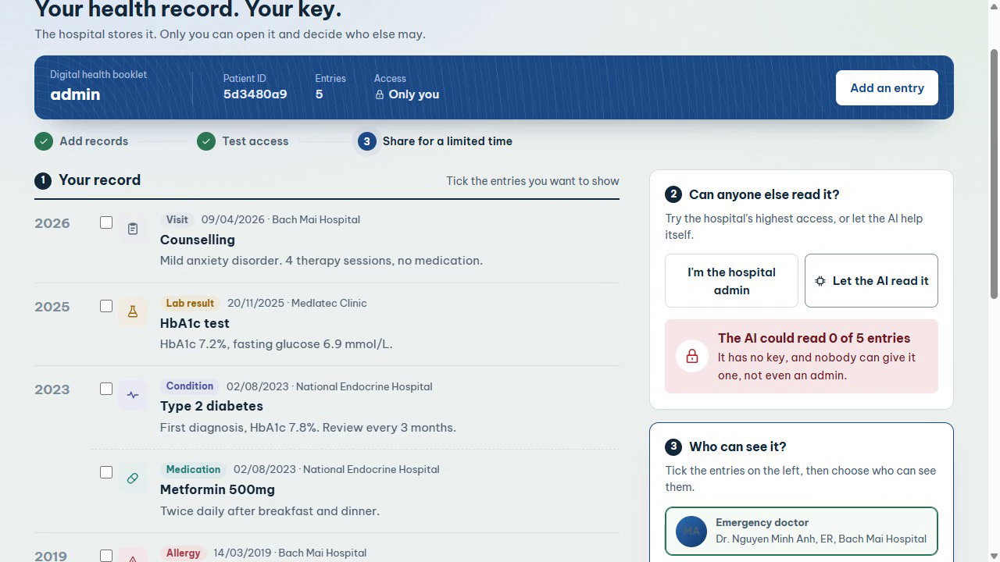
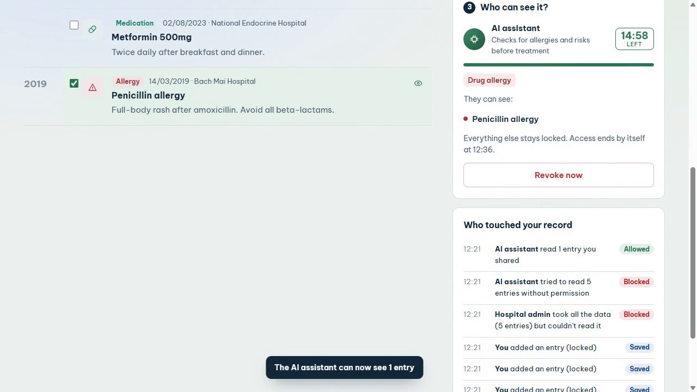
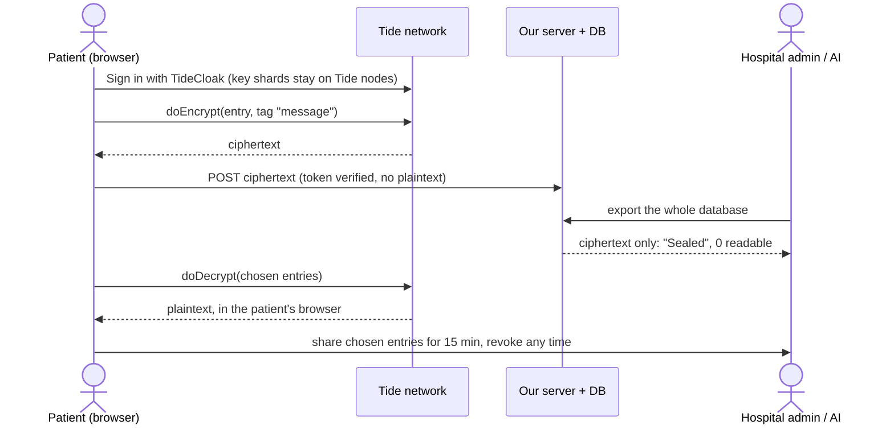

[](https://tide.org/tidecloak?utm_source=github&utm_medium=readme&utm_campaign=unlocked)

## Project overview

_Care Passport VN: a patient-held health record that no hospital admin, insurer or AI can open without the patient's own key._

Built with [TideCloak](https://tide.org/tidecloak?utm_source=github&utm_medium=readme&utm_campaign=unlocked).

### 1. Vision & originality

Vietnam is moving health records online and adopting AI triage. We keep that digital health book, but make the patient, not the database, the gatekeeper. Hospitals still store records and AI still helps, but each reads only what the patient hands over, for as long as they allow.

### 2. Trust constraint insight

Today whoever runs the server can read everything, and so can anyone who breaches it. So patients hide HIV status or mental-health history from doctors, and clinics avoid AI tools. Once no single party holds the key, a hospital can keep data it cannot read, and consent becomes enforceable rather than a checkbox.

### 3. Value & impact

A student with an anxiety diagnosis and a penicillin allergy can show only the allergy to an ER doctor or an AI triage bot. A leaked hospital database becomes useless ciphertext. Clinics can adopt AI without holding plaintext, matching Vietnam's new law that treats health data as sensitive.

### 4. Why TideCloak matters

Each entry is encrypted in the browser with TideCloak `doEncrypt`/`doDecrypt`, bound to the patient's Tide identity. The key is split across the Tide network and never assembled on our server. With an ordinary login, our server could decrypt everything. With TideCloak, it cannot.

### 5. Prototype & storytelling

**Add records**: each is sealed before it leaves the browser. **Test access**: *I'm the hospital admin* returns only scrambled text stamped *Sealed*; *Let the AI read it* returns 0 readable entries. **Share**: give a doctor or the AI chosen entries for 15 minutes, with a countdown and *Revoke now*. Every attempt is logged for the patient.

Demo video: [`demo.mp4`](demo.mp4)

## Demo

https://github.com/duythinhpham07/care-passport-vn/raw/main/demo.mp4

| Your record, sealed per entry | The admin gets the whole database… | …and the AI reads nothing | Share one entry, then revoke |
|---|---|---|---|
|  |  |  |  |

## How it works



## Who can read what

| Who tries | What they get | Why |
|---|---|---|
| The patient | Every entry | Decrypts with their own Tide identity, in their browser |
| Hospital admin with full DB access | Ciphertext only | No key on the server, ever |
| AI assistant on its own authority | 0 readable entries | Holds no key, and no admin can grant one |
| Attacker who steals the database | Ciphertext only | Same reason: nothing to steal that decrypts it |
| Doctor or AI the patient chose | Only the chosen entries, until revoked or expired | The patient decrypts and hands them over |

## TideCloak integration

```ts
// app/home/page.tsx: seal in the browser before anything is sent
const cts = await doEncrypt(entries.map(e => ({ data: JSON.stringify(e), tags: ['message'] })))
// ...and open again only for the signed-in patient
const [plain] = await doDecrypt([{ encrypted: r.ciphertext, tags: ['message'] }])

// app/lib/auth.ts: the server only verifies who is calling; it stores ciphertext it cannot read
const user = await verifyTideCloakToken(tcConfig, token, ['offline_access'])
```

The `message` tag maps to the `_tide_message.selfencrypt` / `.selfdecrypt` roles provisioned in `init/realm.json`.

## Roadmap

- **Break-glass emergency access** that needs two people to agree (e.g. ER doctor + next of kin), using TideCloak's quorum-enforced governance instead of a single admin override.
- **Policy-bound sharing**: move expiry and scope into Tide-enforced policy, so a share ends cryptographically, not only in the app.
- **Records that travel**: the same sealed passport opened by a clinic in Melbourne, without either hospital holding the key.

## Honest limits of this prototype

Synthetic data only. The doctor and AI recipients are simulated in the same app; the AI is a rule-based mock, not an external model. Time-limited sharing is enforced by the app today (see Roadmap).

## Setup

Requirements: Docker, Node ≥ 20.9, `curl`, `jq`, bash (Linux/WSL).

```bash
# 1. Start TideCloak (dev)
docker run --name mytidecloak -d -p 8080:8080 \
  -e KC_BOOTSTRAP_ADMIN_USERNAME=admin -e KC_BOOTSTRAP_ADMIN_PASSWORD=password \
  tideorg/tidecloak-dev:latest

# 2. Install and provision the realm (prints a Tide enrollment link to open)
npm install
npm run init          # writes tidecloak.json

# 3. Run
npm run dev           # http://localhost:3000
```

Key files: `app/home/page.tsx` (record timeline, time-limited sharing, access log), `app/api/records` (ciphertext-only storage, Tide token verified), `app/api/hospital-db` (simulated admin export), `app/api/ai` (mock AI triage, synthetic data only), `app/api/access-log`.

Team **oldbie** (PTIT, RMIT Hackathon 2026, Hanoi).
